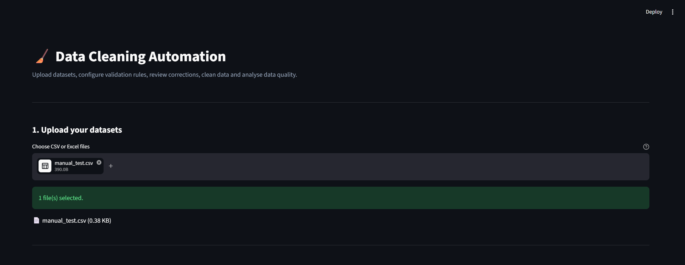
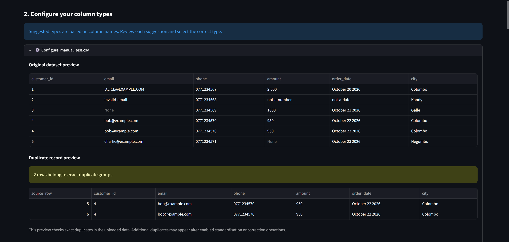
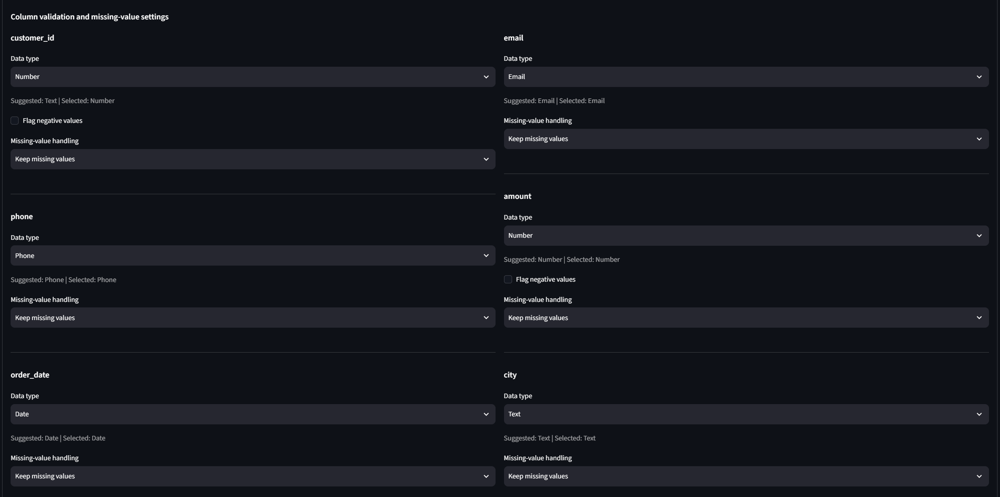
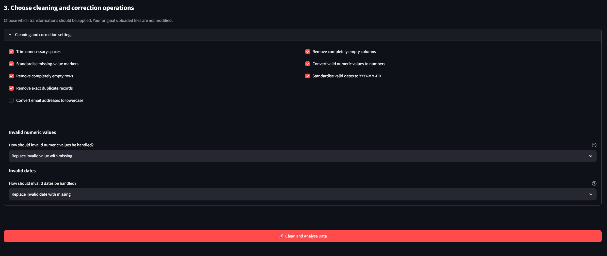
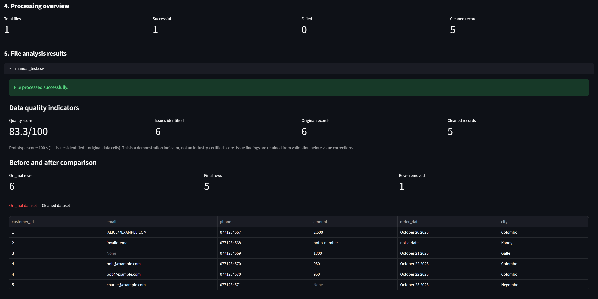
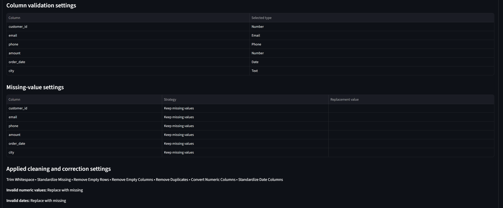
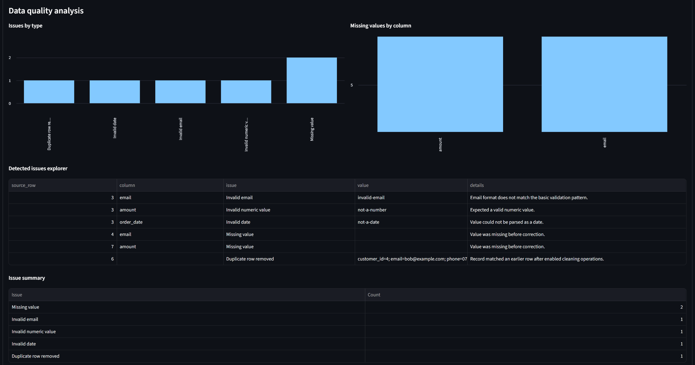
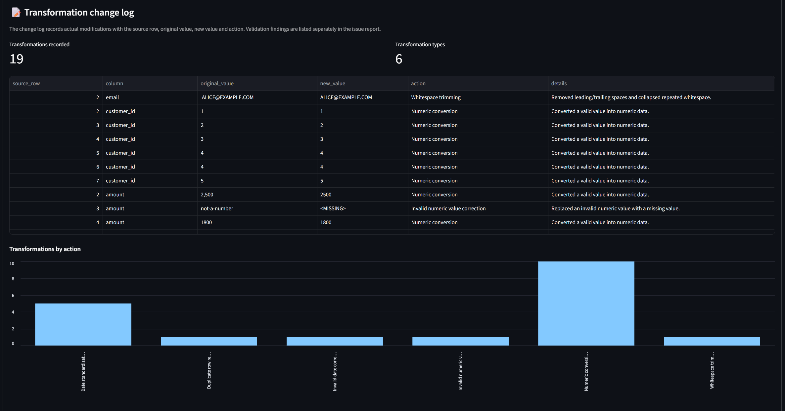
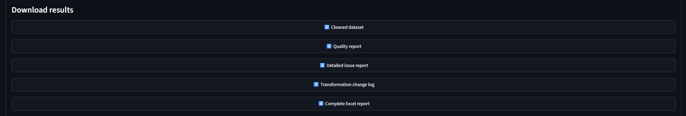

# Python Data Cleaning Automation

A Python-based data cleaning and data quality analysis application with an interactive Streamlit dashboard. Upload CSV and Excel datasets, configure validation rules, clean inconsistent data, inspect data quality issues, track transformations, and download comprehensive reports.

## Application Overview

This application automates common data preparation tasks and provides an interactive interface for understanding and improving dataset quality.

Users can configure column-specific validation rules, choose how missing and invalid values are handled, perform cleaning operations, compare original and cleaned datasets, and export detailed reports.

## Application Screenshots

### 1. Dashboard Overview



### 2. Original Dataset Preview



### 3. Column Validation Settings



### 4. Cleaning and Correction Options



### 5. Processing Overview



### 6. Configuration Summary



### 7. Data Quality Analysis



### 8. Transformation Change Log



### 9. Download Results



## Key Features

### Dataset Upload and Preview
- Upload CSV and Excel (`.xlsx`) files.
- Upload multiple datasets through the application.
- Preview original data before processing.
- Inspect exact duplicate records.

### Configurable Column Validation

Choose a data type for each column:

- Auto
- Text
- Email
- Phone
- Number
- Date
- Ignore

### Data Cleaning
- Trim unnecessary leading and trailing whitespace.
- Standardise common missing-value markers.
- Remove completely empty rows.
- Remove completely empty columns.
- Detect and remove exact duplicate records.
- Convert email addresses to lowercase.
- Convert valid numeric values.
- Standardise valid dates to `YYYY-MM-DD`.

### Data Quality Validation
- Identify missing values.
- Validate email addresses.
- Validate phone number formats.
- Detect invalid numeric values.
- Detect invalid date values.
- Optionally flag negative numeric values.
- Review issues through a detailed issue explorer.

### Missing-Value Management

Configure missing-value handling independently for each column. Options include retaining missing values or replacing them with a specified value.

### Invalid Data Correction

Choose how invalid numeric and date values should be handled:

- Keep and report.
- Replace invalid values with missing values.

### Interactive Data Quality Dashboard

Review:
- Data quality indicators.
- Original and cleaned dataset comparisons.
- Issue summaries.
- Missing values by column.
- Detected issues by type.
- Detailed issue records.
- Transformation history.
- Visual summaries of applied transformations.

### Transformation Change Log

Record data modifications with:

- Source row.
- Column name.
- Original value.
- New value.
- Transformation action.
- Details of the modification.

### Downloadable Reports

The application generates five downloadable outputs:

1. Cleaned dataset.
2. Data quality report.
3. Detailed issue report.
4. Transformation change log.
5. Complete Excel quality report.

The complete Excel report contains seven worksheets:

- Cleaned Data
- Issue Log
- Change Log
- Summary
- Column Settings
- Missing Settings
- Cleaning Settings

## Technology Stack

| Technology | Purpose |
|---|---|
| Python | Core programming language |
| Pandas | Data manipulation and cleaning |
| Streamlit | Interactive web application |
| Plotly | Data visualisation |
| OpenPyXL | Excel processing and reporting |
| Unittest | Automated testing |

See `requirements.txt` for the complete dependency list.

## Project Structure

```text
Python_Data_Cleaning_Automation/
│
├── assets/
│   └── screenshots/
│       ├── dashboard-overview.png
│       ├── dataset-preview.png
│       ├── column-validation-settings.png
│       ├── cleaning-options.png
│       ├── processing-overview.png
│       ├── configuration-summary.png
│       ├── data-quality-analysis.png
│       ├── transformation-change-log.png
│       └── download-results.png
│
├── input/
│   ├── sample_customers.csv
│   ├── sample_customers_excel.xlsx
│   ├── advanced_sample_customers.csv
│   ├── manual_test.csv
│   └── transformation_test.csv
│
├── output/
│   └── .gitkeep
│
├── app.py
├── main.py
├── test_main.py
├── requirements.txt
├── README.md
└── .gitignore
```

Generated files in `output/`, Python cache files, and virtual environments are excluded from version control.

## Installation and Setup

### Prerequisites

- Python 3
- pip
- Git
- Visual Studio Code (recommended)

### 1. Clone the Repository

```bash
git clone https://github.com/AnudaIsuranga/python-data-cleaning-automation.git
```

Navigate to the project directory:

```bash
cd python-data-cleaning-automation
```

### 2. Create a Virtual Environment

Windows PowerShell:

```powershell
py -m venv venv
```

### 3. Activate the Virtual Environment

```powershell
.\venv\Scripts\Activate.ps1
```

### 4. Install Dependencies

```bash
python -m pip install --upgrade pip
pip install -r requirements.txt
```

### 5. Run the Application

```bash
python -m streamlit run app.py
```

Open the application in your browser:

```text
http://localhost:8501
```

## Running Automated Tests

Run the automated test suite with:

```bash
python -m unittest -v test_main.py
```

The current test suite contains 11 tests covering:

- Numeric, date and email transformations.
- Missing-value replacement.
- Duplicate removal and preservation.
- Ignored-column validation.
- Invalid numeric value correction.
- Invalid date correction.
- Excel report generation.
- Excel input processing.
- Empty-row removal.
- Missing values in an entire column.

All 11 automated tests passed in the development environment.

## How to Use

1. Launch the Streamlit application.
2. Upload one or more CSV or Excel datasets.
3. Preview the original data.
4. Configure column data types.
5. Choose missing-value handling strategies.
6. Select the cleaning and correction operations.
7. Configure invalid numeric and date handling.
8. Click **Clean and Analyse Data**.
9. Review the data quality indicators and detected issues.
10. Inspect the transformation change log.
11. Download the cleaned dataset and reports.

## Data Quality Score

The application displays a demonstration data quality score based on the number of identified issues relative to the original number of data cells.

This is a project-specific indicator, not an industry-certified data quality measurement.

Issue findings are recorded before corrections so the reports can preserve an audit trail of the original data-quality problems.

## Development and Testing Status

Verified during development:

- 11 automated unit tests passed.
- CSV processing through the Streamlit interface.
- CSV and Excel processing through the core cleaning engine.
- Data validation and transformation logging.
- Generation of downloadable reports.
- Manual verification that the five output files download and open.

Additional testing is required before treating the application as a production-ready service.

## Future Improvements

Potential future improvements include:

- More advanced validation rules.
- Customisable email and phone validation patterns.
- Additional file formats.
- Improved large-dataset performance.
- More advanced data profiling.
- Cloud deployment.
- User authentication and access control.
- Automated cleaning recommendations.

## Disclaimer

This is a portfolio application for data cleaning and quality analysis. Users should review the configuration and generated outputs before using cleaned datasets in business-critical workflows.

## Author

Developed as a Python data automation and data quality portfolio project by Anuda Isuranga.

GitHub: https://github.com/AnudaIsuranga